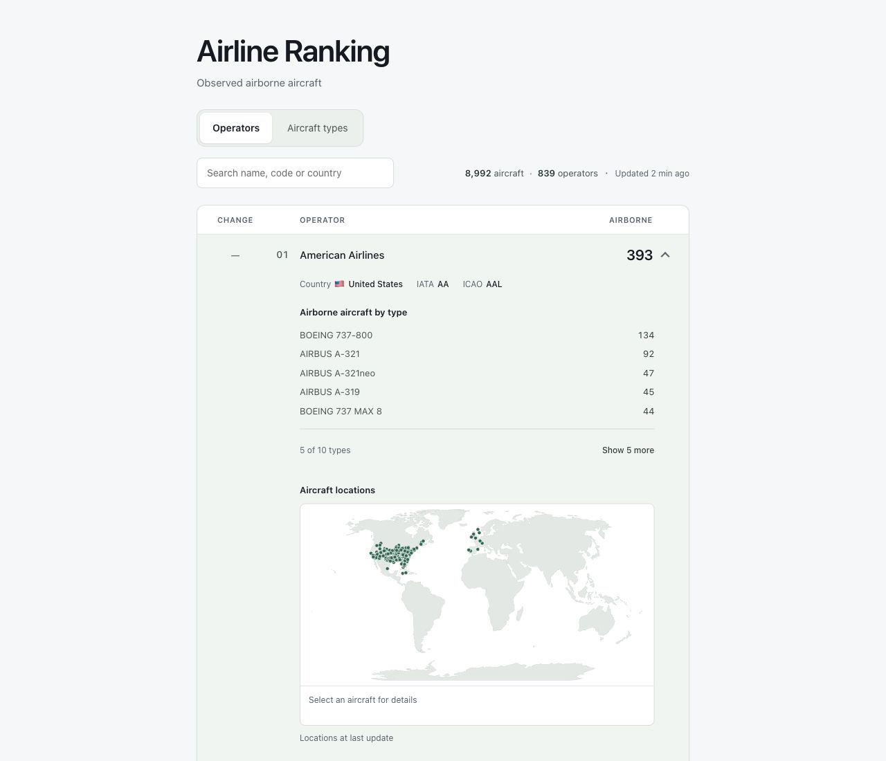
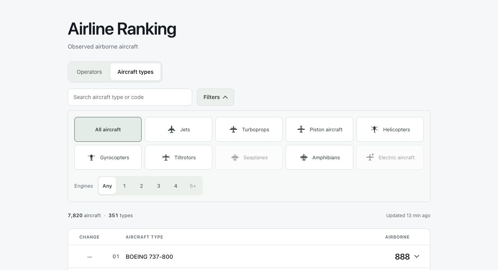
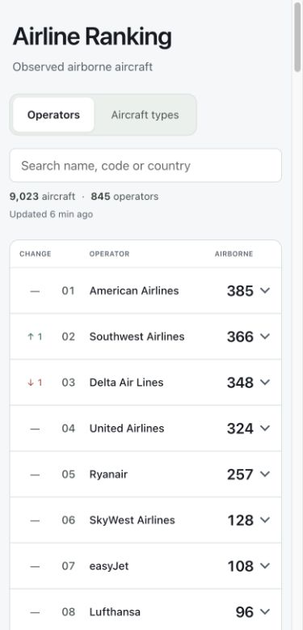
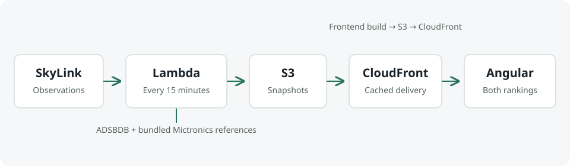

# Airline Ranking

Observed airborne aircraft, ranked by operator and aircraft type. Explore rank changes, fleet breakdowns and aircraft locations in one shared snapshot.

[](https://github.com/kuosmark/airline-ranking/actions/workflows/check.yml)
[](https://github.com/kuosmark/airline-ranking/releases/latest)
[](LICENSE)

**[Open the live app →](https://airlines.markuskuosmanen.com/)**



*Operator details and aircraft locations from an observed snapshot. Counts and positions change between refreshes.*

## Explore the rankings

- **Two perspectives:** switch between operators and ICAO aircraft types, with rank movement since the previous snapshot.
- **Fleet details:** expand a row for its breakdown and aircraft map; select a marker for callsign, type and reported altitude.
- **Search:** find operators by name, code or country, and aircraft types by name or ICAO code.
- **Inclusive totals:** aircraft without an identified operator or type remain visible in separate expandable sections.
- **Responsive controls:** keyboard-accessible maps, touch targets and reduced-motion support.



<details>
<summary>See the mobile layout</summary>



</details>

These are observed aircraft counts, not worldwide fleet totals. Coverage depends on SkyLink. Refreshes run every 15 minutes; if a refresh fails, the last successful snapshot remains visible with a delay notice. [Read the grouping and identification rules](docs/ranking.md).

## How it works



A TypeScript Lambda validates and deduplicates the observations, builds both rankings and saves a shared snapshot. Operator metadata comes from ADSBDB; bundled Mictronics references supply aircraft type names and an ICAO24 fallback.

- **Shared cached data:** visitors read through CloudFront; opening drawers and maps makes no provider requests.
- **Bounded provider usage:** one scheduled poller, persisted request reservations and lookup limits protect the request budget.
- **Verified deployments:** GitHub Actions checks pull requests. Merges to `main` trigger CodePipeline and CodeBuild, which check, publish and verify the homepage and ranking response. Infrastructure changes require a separate reviewed deployment.

Built with Angular, TypeScript, Node.js and AWS CDK. [Explore the architecture](docs/architecture.md).

## Run locally

Requires Node.js 22.13+ (22.x) or 24.x, `zip`, `unzip` and Python 3 for release-packaging checks. You need a SkyLink API key to fetch live data; tests need no credentials.

```sh
npm ci
```

Create an untracked `.env` file containing `SKYLINK_API_KEY=your-api-key`. Start the backend and frontend in separate terminals:

```sh
npm run backend
```

```sh
npm start
```

Open [localhost:4200](http://127.0.0.1:4200/). The backend fetches immediately and every 15 minutes. **Use only one active poller per API key**; stop the cloud schedule before running locally with the same key.

```sh
npm run check
```

Runs lint, type checks, tests, the frontend build and infrastructure synthesis without provider requests. [Full development instructions](docs/development.md).

## Documentation

- [Ranking and data](docs/ranking.md) — filtering, grouping, movement and metadata.
- [Architecture](docs/architecture.md) — components, backend state and scheduled refreshes.
- [Deployment and operations](docs/deployment.md) — setup, automatic releases, recovery and retirement.
- [Aircraft reference](backend/data/README.md) — provenance, attribution and monthly updates.
- [Contributing](CONTRIBUTING.md) — proposing changes and verification expectations.

## Licence and attribution

Project-owned code and documentation are available under the [MIT licence](LICENSE). Third-party data and assets retain their own terms:

- **Mictronics aircraft reference:** Open Data Commons Attribution License; see [provenance and retained licence](backend/data/README.md).
- **Natural Earth map outline:** [public domain](https://www.naturalearthdata.com/about/terms-of-use/).
- **SkyLink observations and ADSBDB metadata:** supplied by their respective services; the project licence does not grant rights to provider data.

Screenshots illustrate the application using observed data captured on 21 October 2026.
