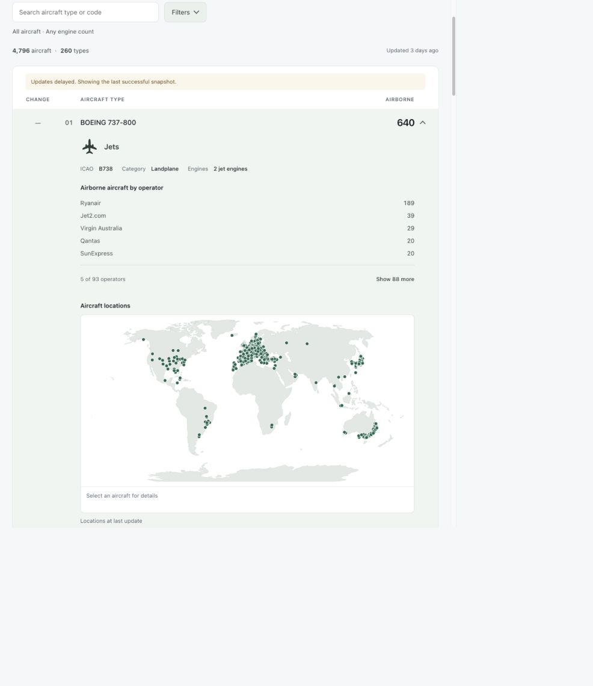

# Ranking and data

[Back to overview](../README.md)

## Ranking behavior

The Aircraft types view offers nine filters: Jets, Turboprops, Piston aircraft, Helicopters, Gyrocopters, Tiltrotors, Seaplanes, Amphibians and Electric aircraft. Landplanes are divided by propulsion; the other aircraft categories remain broad groups. Each type drawer uses the same group label and shared silhouette as its filter, followed by exact ICAO, Category and Engines metadata. Silhouettes are representative, not model-specific; seaplanes and amphibians share a symbol. Unsupported landplane propulsion stays under All aircraft with its available metadata. Missing classifications use a neutral symbol and “Classification unavailable”.

The Filters panel starts closed and retains its open/closed state when switching ranking tabs. Category buttons keep a fixed order, equal width and height, with five columns when the panel content is at least 880px wide and two otherwise. Categories absent from the snapshot stay visible but disabled; a selected category remains available if it disappears on refresh. The Engines control offers Any, 1, 2, 3, 4 and 5+. Missing or special zero counts only match Any. Counts absent from the selected category are disabled.

- Clicking a selected category returns to All aircraft. Engines is single-choice: clicking its active value keeps it selected; Any clears that restriction.
- Selecting a different category clears an incompatible engine selection. Search combines with both filters; ranks and rank changes remain global.
- Changing either filter resets pagination and closes the aircraft drawer. Switching ranking views clears search and selections. Reset filters clears all three, including while the panel is closed.
- Collapsing the panel preserves selections and shows their summary. The Filters button counts active category and engine restrictions, excluding search.
- Unknown type is shown only with All aircraft and Any engine count. Category or engine filtering hides it; search alone does not filter the separate Unknown section.
- With a filter or search, the aircraft total sums all matching ranking rows, including those beyond the visible page. With neither, it shows the full snapshot total, including unidentified aircraft. Operator search follows the same total-count rule.

Search stays at a maximum width of 320px regardless of count text. Result counts and snapshot age sit above the ranking. Reset filters reserves its space when inactive so appearing/disappearing does not move the table. Selected category and engine buttons use semibold text.

The leaderboard initially displays 100 rows. A single “Show 100 more” button reveals the next batch, shows progress and disappears once all matching rows are visible. Search filters the full current snapshot by operator name, ICAO code, IATA code or directory-listed country, ignoring case and surrounding spaces. The observed callsign prefix remains searchable when directory details are unavailable. Country searches refer to the operator’s listed country, not aircraft locations. Results keep their original leaderboard ranks and update with the cached snapshot. Changing the search resets the visible limit to 100. A clear button appears when the field contains text; its touch target is at least 44 × 44 pixels. Clearing the search restores focus to the input and shows the first 100 rows. Loading more rows and searching make no additional requests.

The browser checks the cache every minute while the tab is visible, pauses polling in hidden tabs, and checks immediately when the tab becomes visible again. Conditional requests use ETags: unchanged responses retain the existing snapshot and avoid parsing and rebuilding the rankings. The snapshot age sits above the table and updates on each browser check. The 15-minute refresh interval sits beside “How does it work” below the table; that disclosure contains the exact UTC timestamp and grouping rules. Column labels and any delay notice stay visible in the sticky table header while scrolling. Rows animate to their new positions; counts update immediately with a brief neutral highlight. Reduced-motion preferences disable these effects. Screen-reader announcements include the new snapshot’s UTC date and time, so successive updates produce distinct announcements; directory-only updates do not announce a new snapshot. If an update fails, the last successful ranking and its original timestamp remain visible with a delay notice. Before the first successful snapshot, the UI shows an unavailable message and retries automatically.

A separate expandable **Unknown operator** card below the ranked table contains airborne aircraft without a usable operator callsign. It remains visible during search and before all operator rows are loaded, has no rank or movement, and opens the same type breakdown and map without operator metadata. It is omitted when empty.

Click an airline to expand its aircraft-type breakdown; only one row is expanded at a time. Opening or closing a drawer preserves the clicked row’s screen position during the animation unless the user starts scrolling or interacting again. Labeled Country, ICAO and IATA fields appear at the top of the drawer and close with it. They use one row when the drawer has enough room and three stacked rows otherwise. Drawer sections and the map share a consistent left edge at every screen width. Above mobile widths, that edge aligns with the operator name; mobile drawers use a smaller inset derived from the row columns to leave more room for their content. Country flags use ADSBDB’s two-letter country ISO codes; emoji rendering varies by platform. Missing metadata fields show “Unavailable”. This is the country supplied by the airline directory, not the aircraft’s current location. Operators displayed as prefixes include a “Name unavailable” hint. Expanded rows use a pale green background; hovering a closed row uses neutral gray. The same cached snapshot supplies both the total and its breakdown, without extra provider requests. The expanded airline stays open when the ranking changes, and its total updates immediately with its breakdown. The breakdown initially shows the five most common types. Its footer shows the number of visible types, with “Show N more” revealing the remaining types and “Show fewer” returning to five. The drawer also shows a world map of valid locations from the same deduplicated airborne observations used for its count. A persistent details strip prompts aircraft selection. Selecting a dot reveals its callsign (or ICAO24 identifier when absent), aircraft type and reported barometric altitude in feet when available; space for two lines reduces layout shifts. Locations update with the snapshot, not continuously; missing locations are reported only when coverage is incomplete. Old snapshots without positions omit the map until the next successful refresh. The map is rendered only in the open drawer and makes no external map or provider requests. Geography is a bundled [Natural Earth](https://www.naturalearthdata.com/about/terms-of-use/) 1:110m land outline (public domain), projected with `d3-geo` using Natural Earth I. The bundled path in `src/world-outline.ts`, SVG viewBox and projection constants in `src/aircraft-map-projection.ts` must remain aligned. Pointer selection uses the nearest dot within 12 screen pixels; the hover highlight and tooltip use the same target. The aircraft markers use one Tab stop. Arrow keys browse aircraft in callsign order (Right/Down advances, Left/Up goes back, wrapping at either end); Enter or Space selects an aircraft, and Tab leaves the map. Pointer selection determines which marker receives focus when returning with Tab. Clicking empty map space preserves the selected aircraft. Dots can overlap around busy airports; this is a fleet overview, not a detailed flight tracker.

Opening an operator starts with five again; the current choice persists across snapshot updates while that operator stays open.

Rank indicators compare each operator's position with the previous successful, distinct snapshot: a green upward arrow with the number of places gained, a red downward arrow with the number of places lost, and “New” for an operator absent from the previous snapshot (including returning operators). A dash marks an unchanged rank (zero movement); a blank cell means no previous snapshot is available. Movement has its own column before the rank. Equal aircraft counts still use prefix order, so indicators reflect row position rather than count changes. Hover text explains the comparison period; screen-reader text describes the direction and number of places. The API represents this as `rankChange`: a signed integer (positive means up, zero means unchanged), `"new"`, or an omitted field when no comparison exists.

Comparison happens in the backend, so browser reloads and different viewers receive the same indicators. Repeated timestamps, name-only updates and failed fetches do not advance the comparison. After an outage, the next successful snapshot compares with the last successful one, even if the gap exceeds 15 minutes. The local backend holds comparison state in memory, so its first snapshot after a restart has no indicators. The scheduled Lambda handler persists the latest comparison in S3 across invocations. Neither mode stores a historical archive or adds provider calls for comparisons.

The **Operators / Aircraft types** switch selects two rankings built from the same
filtered, deduplicated SkyLink observations. Switching clears search, pagination
and the open drawer. Type search matches the display name or ICAO type code.
Aircraft types are grouped by ICAO designator matched against the bundled
reference, ordered by airborne count
and then code. Each drawer shows its ICAO code, aircraft category and readable engine count/type from the bundled Mictronics classification. Missing or unsupported metadata displays as Unavailable; a zero engine-count code is treated as unknown. Classification labels follow [Mictronics readsb](https://github.com/Mictronics/readsb/blob/master/webapp/src/script/readsb/aircraftFilter.ts); turbine propulsion is described as turboprop for aeroplanes and turboshaft for rotorcraft. Older snapshots without classifications remain valid. Each drawer also shows operator counts (including Unknown
operator) and the aircraft map. The operator breakdown initially shows five entries
and can be expanded. Unknown type contains airborne aircraft whose type is missing
or could not be matched to a specific ICAO aircraft type. This includes generic
descriptions for which neither code/name matching nor the ICAO24 fallback provides a specific type. These aircraft remain included in the total and have their own expandable
operator breakdown and map outside the ranked list; the section remains visible
during search and is omitted when empty. Both rankings reconcile to the same
total, even when positions are missing. Type rank changes use a separate previous-snapshot comparison; the first
snapshot after upgrading has no type movement indicators.

`backend/data/mictronics-aircraft-types.json` is derived from the Mictronics aircraft
database under the Open Data Commons Attribution License; see [reference provenance and update instructions](../backend/data/README.md).
The lookup adds no runtime requests. It trims SkyLink's `aircraft_type`, takes the
last whitespace-separated word and uppercases that code for a Mictronics lookup.
If the code lookup fails, it compares the entire description against all bundled
reference names, ignoring case, whitespace and hyphens. Only names belonging to
exactly one ICAO code are accepted; ambiguous names remain unmatched.
If neither matches, a bundled ICAO24 aircraft reference supplies the type code,
unless both sources provide registrations and they disagree after removing spaces
and hyphens and ignoring case. The resulting code must exist in the type-name
reference. Missing registrations permit the fallback; reference records can be
outdated, so this is not a verified aircraft identification. Existing code/name
matches take priority. Both tabs, operator breakdowns and map details use the
resolved reference name unchanged.
There are no manual aliases or name overrides. Missing, generic and unmatched
values remain in the Unknown type group when the ICAO24 fallback also fails. Operator breakdowns and map details
preserve non-empty unmatched SkyLink descriptions, trimming only surrounding
whitespace; missing descriptions display as Unknown type. A matching code is a heuristic, not a guarantee
of the provider's classification. Display names represent types rather than exact
model variants. The snapshot adds optional
`aircraftTypeRankings` and `unknownAircraftType` fields together. Older snapshots
remain supported and show an availability message in the type view until refresh.
Operator names in type drawers come from the existing enriched operator directory.
The Unknown type drawer also lists reported SkyLink descriptions with counts, including aircraft without positions. Missing descriptions appear as “Description unavailable”. This breakdown does not assign ICAO codes or add ranked types.

The monthly reference workflow runs `scripts/update-aircraft-types.ts` with Node.js. For a local import, run `node --experimental-strip-types scripts/update-aircraft-types.ts PATH_TO_EXPORT.zip`. The importer rejects duplicate JSON keys, malformed records, changed licences and removals exceeding 5% of either existing reference. All validation completes before reference files are written. Its tests run with the JavaScript suite in `npm run check`.

Operator drawer type breakdowns use the same Mictronics lookup as the aircraft-type ranking. Unmatched labels retain the original SkyLink description with surrounding whitespace trimmed; missing descriptions share an Unknown type entry. Breakdown counts always sum to the operator total.

One continuously running local backend makes approximately 96 aircraft-snapshot requests per day. Every local backend restart adds an immediate request; opening more browser tabs does not trigger more provider requests. Failed requests are retried at the next scheduled refresh.

## Operator details and lookup costs

Names, countries, IATA codes and ICAO codes come exclusively from [ADSBDB's airline endpoint](https://www.adsbdb.com/#get_route_airline), queried by the observed three-letter prefix for operators in the snapshot. Returned ICAO codes must match the prefix. Duplicate records must agree on a name; conflicting names remain unavailable. Missing or conflicting countries and IATA codes remain unavailable independently. IATA codes can contain digits and some operators have no IATA code. No SkyLink directory requests or metadata fallback are used. The observed prefix still controls grouping and tie-breaking; a directory match does not prove every callsign belongs to that operator.

The backend publishes the ranking before directory lookups complete. Unresolved operators display their observed prefixes and unavailable metadata. Browsers receive resolved details on their next normal poll. Directory-only updates keep the snapshot timestamp and do not trigger movement or count highlights.

`.cache/operator-names.json` is excluded from Git. AWS uses the same structure in the private `operator-names.json` state object:

```json
{
  "source": "adsbdb",
  "names": {
    "FIN": { "name": "Finnair", "country": "Finland", "countryIso": "FI", "iata": "AY", "icao": "FIN", "checkedAt": "2026-10-07T12:00:00.000Z" }
  },
  "attempts": [1791374400000],
  "cooldownUntil": 0
}
```

The source marker separates ADSBDB metadata and its budget from the old SkyLink cache. On first load of a valid legacy cache, migration discards its labels and archives its paid `attempts` and `cooldownUntil` under `legacySkylink`. The new ADSBDB cache starts empty and the migration is persisted before provider requests. It happens once and retains the original state file and conditional S3 write protections; no additional storage resource is needed. Failed migrations disable requests. Do not delete state files to refresh metadata or reset quotas.

Existing ADSBDB cache entries without `countryIso` remain valid and are eligible for a one-time refresh during scheduled directory enrichment. The existing per-refresh and rolling request limits still apply. Entries with unavailable ISO codes retain their normal expiry interval.

`checkedAt` uses ISO timestamps; `attempts` and `cooldownUntil` use Unix milliseconds. Constants in `backend/operator-directory.ts` enforce:

| ADSBDB control | Value |
| --- | --- |
| Known record refresh | 30 days |
| Missing or ambiguous record refresh | 7 days |
| Cooldown after a failed lookup | 24 hours |
| Maximum lookup attempts | 5,000 per rolling 32 days |
| Maximum attempts per refresh | 100 |
| Minimum spacing between requests | 1 second |

These are application guardrails, not purchased allowances. ADSBDB's [published rate limits](https://www.adsbdb.com/) currently block clients at 512+ requests within 60 seconds for 60 seconds, and at 1,024+ for 300 seconds. Its implementation limits by IP. Our sequential, paced lookups stay below these thresholds, but shared outgoing IPs or provider policy changes can still cause throttling. No monthly allowance or availability guarantee was found. The public API's software is MIT-licensed; an explicit separate licence for caching and displaying airline records has not been confirmed. The site's copying restriction explicitly refers to flight-route data, which this application does not fetch.

Expiry is checked only during snapshot refreshes for operators in the current snapshot. Every attempt is persisted before contacting ADSBDB, with a provisional cooldown to prevent immediate retries after crashes. Successful responses clear the cooldown. HTTP 404, empty results and ambiguous names are completed negative lookups; malformed responses, HTTP 429, server errors and timeouts stop the batch and retain previous ADSBDB data. Missing optional fields do not shorten a known record's TTL. No immediate retries or paid fallback occur. Lookup pacing survives restarts; the Lambda deadline can stop a batch before the batch limit, and remaining prefixes are checked on subsequent scheduled refreshes. Operators without cached details remain visible as prefixes while bounded batches populate their details over subsequent refreshes. Reads and searches never trigger provider calls.

Local writes replace the cache via a temporary file and rename. Unreadable or invalid caches and failed writes disable lookups. The local cache requires a single backend process; sharing it between concurrent local processes is unsupported. Lambda uses conditional S3 writes to reject conflicting updates. Cached provider output remains outside the public repository.

SkyLink is used only for airborne snapshots. A single continuously running poller needs 2,976 requests in 31 days (3,072 in 32 days). Production reserves each 15-minute slot before fetching, with no automatic request retries, and persists a separate maximum of **3,100 snapshot attempts per rolling 32 days** in `refresh-state.json`. Failed requests consume their reservation. Reaching the cap stops paid snapshot fetches until attempts expire; the last published snapshot remains available and becomes stale. Storage failures prevent unreserved requests.

Older scheduled state records only the last attempted slot. Migration conservatively seeds snapshot history as if every slot in the preceding 32-day window through that slot was attempted, rather than granting a fresh budget. New installations with a null last slot start with empty history. Redeployments retain this history. Historical SkyLink directory attempts remain archived separately and still count toward provider billing during the transition. These guards apply to this production poller, **not the entire SkyLink subscription**: local backend startup and polling, manual tests, other instances and external usage are additional. SkyLink's [direct-subscription terms](https://skylinkapi.com/terms/) permit billed overage; monitor usage and any provider-side spending controls.




*Aircraft type metadata and operator breakdown from an observed snapshot.*
